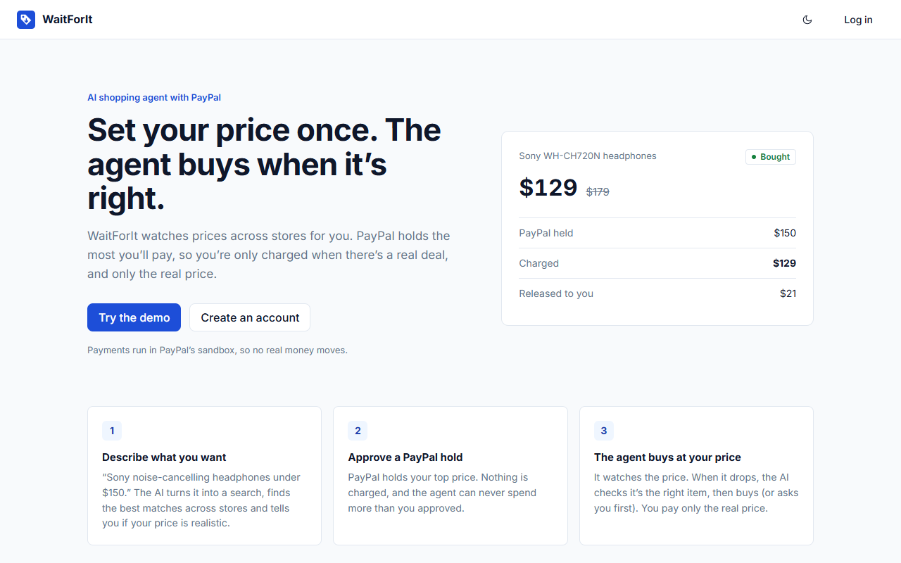
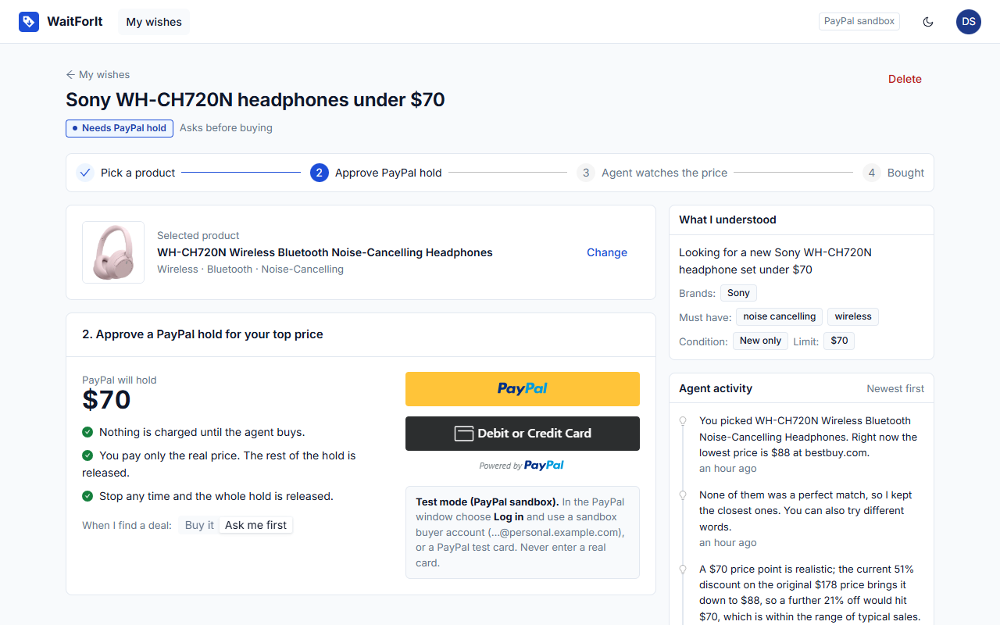
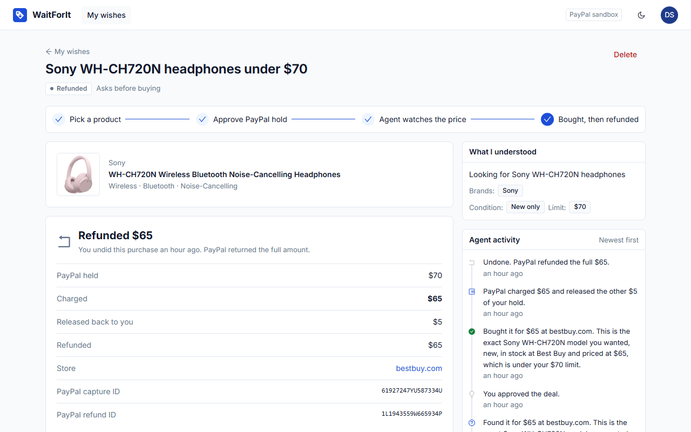

# WaitForIt

**Set your price once. An AI agent buys when it's right.**

WaitForIt is an AI shopping agent. You describe what you want and the most you'll pay. The agent finds the best matching products across stores, tells you whether your price is realistic, and watches the price. PayPal holds your top price, so when the price drops the agent can buy right away (or ask you first), and you pay **only the real price**. The rest of the hold is released.

**Live demo:** https://waitforit-web.onrender.com (click **Try the demo**; the free server may take up to a minute to wake up)



## The everyday problem

You want something, like headphones, but not at today's price. So you keep checking, set reminders, and still miss the sale. Price-alert tools only send a notification. By the time you see it, the deal may be gone, and you still have to check out yourself.

WaitForIt closes the loop: it **watches and pays for you**, and it can never spend more than you approved.

## How it works

```mermaid
flowchart LR
  A["You: 'Sony WH-CH720N<br/>headphones under $70'"] --> B["AI reads the wish<br/>(brand, must-haves, new/used, limit)"]
  B --> C["Channel3 search<br/>across stores"]
  C --> D["AI ranks matches<br/>+ fair-price advice"]
  D --> E["You pick one and approve<br/>a PayPal hold for $70"]
  E --> F["Agent watches the price"]
  F -->|price ≤ $70| G["AI verifies the listing<br/>(same model, new, in stock)"]
  G -->|Auto-buy| H["PayPal captures $65,<br/>releases $5"]
  G -->|Ask me first| I["You approve"] --> H
  H --> J["Undo within 24 h<br/>= PayPal refund"]
```



| Step | What happens |
|---|---|
| 1. Describe | Type a wish in plain words. The AI turns it into a search plan: product, brands, must-haves, things to avoid, new or used, and your limit. Non-products ("a plumber tomorrow") are refused. |
| 2. Choose | Channel3 searches many stores. The AI scores each result for how well it matches (price is hidden from this step, so an expensive exact match still scores 100%) and drops accessories and wrong models. It also says whether your limit is **realistic, a stretch or unlikely**, using current and "was" prices. |
| 3. Hold | You approve a **PayPal hold** for your limit. Nothing is charged. |
| 4. Watch | The agent re-checks the price on a timer, or when you click **Check now**. Every step is written to an **activity log** in plain words. |
| 5. Buy | When the price reaches your limit, the AI checks the listing (same model, new, in stock, normal store). In **Auto-buy** mode it buys; in **Ask me first** mode it shows you the deal and waits for **Approve**. |
| 6. Undo | Changed your mind? **Undo purchase** within 24 hours sends a full PayPal refund. |

## How PayPal is used

PayPal is the core of the product, not a checkout button at the end. WaitForIt uses the **Orders v2 API with `intent: AUTHORIZE`** to turn your price limit into a real spending cap.

| Moment | PayPal API | Why |
|---|---|---|
| You approve your limit | `POST /v2/checkout/orders` (intent `AUTHORIZE`) + PayPal JS SDK buttons, then `POST /v2/checkout/orders/{id}/authorize` | Places a **hold** for your top price. Nothing is charged. |
| The agent buys | `POST /v2/payments/authorizations/{id}/capture` with a **lower amount** and `final_capture: true` | Charges **only the real price**; PayPal releases the rest of the hold automatically. |
| You stop watching | `POST /v2/payments/authorizations/{id}/void` | Releases the whole hold. |
| You undo a purchase | `POST /v2/payments/captures/{id}/refund` | Full refund within 24 hours. |
| Every money call | `PayPal-Request-Id` header | Retries can never charge twice. |

## How AI is used

The AI (open-weight models on Groq) does the judging. **Plain code enforces the money rules**, so the AI can never overspend.

| AI job | Model |
|---|---|
| Read the wish into a structured search plan (and refuse non-products) | gpt-oss-20b, JSON schema output |
| Score search results against the wish, ignoring price | gpt-oss-20b |
| Fair-price advice: is the limit realistic? | gpt-oss-20b |
| Buy decision: is this listing really the chosen product, new, in stock, from a normal store? | gpt-oss-120b |

**Guardrails in code, not prompts:**
- The agent can never capture more than the PayPal hold.
- Only one purchase per wish: a database lock (`findOneAndUpdate` on status) means two checks at the same moment can't both buy.
- Expired holds stop the wish without charging.
- Store and product text is treated as data, not instructions (prompt-injection resistant).

## Try it (judges)

1. Open the [live demo](https://waitforit-web.onrender.com) and click **Try the demo**.
2. Type a wish, e.g. `Sony WH-CH720N headphones under $70`, choose **Auto-buy** or **Ask me first**, and click **Start shopping**.
3. Pick a product, then approve the PayPal hold. This is the **PayPal sandbox** (test money):
   - Choose **Log in** in the PayPal window and use any PayPal **sandbox buyer** account, or
   - Click **Debit or Credit Card** and use a PayPal test card (e.g. Visa `4032 0393 1798 4658`, any future expiry, any CVV, any US address).
4. Real price drops can take days, so use the **Simulate drop** box to pretend the store dropped its price below your limit. The PayPal hold, capture, release and refund are all **real sandbox transactions**.

> **Honest scope:** this is a hackathon prototype. Product search and prices are real (Channel3). Payments are real PayPal sandbox transactions, with WaitForIt as the merchant. Placing the order at the retailer (for example through Channel3's checkout or affiliate links) is the next step and is not done yet.




## Tech stack

| Layer | Tools |
|---|---|
| Website | **Next.js 16 (App Router) + TypeScript**, React 19, Ant Design 6, TanStack Query, exported as a static site |
| API | Node.js, Express 5, Zod validation, JWT auth, Helmet, rate limiting, gzip |
| Data | MongoDB Atlas (Mongoose) with compound indexes |
| AI | Groq (gpt-oss-20b / gpt-oss-120b), JSON-schema structured output |
| Products & prices | Channel3 API |
| Payments | PayPal Orders v2 (authorize, partial capture, void, refund) + PayPal JS SDK |
| Hosting | Render (static site + web service) via `render.yaml` |

## Testing

**63 automated tests**, all passing.

| Suite | Tools | Covers |
|---|---|---|
| API: 36 tests | Node test runner, **Supertest**, in-memory MongoDB, fake PayPal / Channel3 / AI | Charging only the real price, never above the hold, buying only once under concurrent checks, Ask-me-first approve/decline, refunds (once, 24 h window), expired holds, AI saying "wait", privacy between users, caching, compression, cache headers |
| Website: 18 tests | **Jest + React Testing Library** (via `next/jest`) | New-wish form, approval card, Undo purchase, fair-price advice, login validation, price chart accessibility |
| End-to-end: 9 tests | **Playwright** (real Chrome) + **axe-core** | Demo login, AI matching to the PayPal step, the full **PayPal sandbox** flow (hold → ask → approve → capture → undo → refund), and WCAG 2.1 AA scans of 5 pages in light and dark mode |

```bash
npm test                      # API tests
npm test --prefix client      # component tests
npm run test:e2e --prefix client   # end-to-end (needs the API and site running, and real keys in .env)
```

## Performance

| Check | Result |
|---|---|
| Lighthouse, desktop | Performance **100**, Accessibility **100**, Best Practices **100**, SEO **100** |
| Lighthouse, mobile | Performance **96**, Accessibility **100**, Best Practices **100**, SEO **100** |
| Page weight | 1,299 KB → **398 KB** with Brotli/gzip and long-lived caching of fingerprinted files |
| API load test (autocannon, 50 connections) | ~2,550 req/s on non-database routes; ~100–113 req/s on database routes (the free Atlas tier allows ~100 ops/s), doubled by caching the per-request account check |

**Caching:** Channel3 searches are reused for 15 minutes (each costs a credit from a monthly quota), product lookups are shared for 2 minutes with in-flight de-duplication, API responses with personal data are `private, no-store`, and `/_next/static` files are cached for a year. The in-memory cache has a get/set/wrap interface that can be swapped for Redis when running more than one instance.

## Run it locally

Requirements: Node 20+, a free MongoDB Atlas cluster, and free keys from [Groq](https://console.groq.com), [Channel3](https://trychannel3.com) and the [PayPal Developer Dashboard](https://developer.paypal.com) (Sandbox app).

```bash
git clone https://github.com/kc-2705/waitforit.git
cd waitforit
npm install
npm install --prefix client
cp .env.example .env          # fill in MONGO_URL, JWT_SECRET, GROQ_API_KEY, CHANNEL3_API_KEY, PAYPAL_CLIENT_ID, PAYPAL_CLIENT_SECRET
node scripts/seed.js          # demo account: demo@waitforit.app / demo12345
npm run dev                   # API on http://localhost:8080
npm run dev --prefix client   # website on http://localhost:4173
```

## Deploy on Render

The repo includes a Render Blueprint (`render.yaml`) with two services: the static website (never sleeps, shows the opening animation while the API wakes) and the API. In Render choose **New → Blueprint**, pick this repo, and paste the secrets when asked: `MONGO_URL`, `GROQ_API_KEY`, `CHANNEL3_API_KEY`, `PAYPAL_CLIENT_ID`, `PAYPAL_CLIENT_SECRET`. In MongoDB Atlas, allow network access from `0.0.0.0/0` (Render's free plan has no fixed IP).

## Project structure

```
server/            Express API
  services/agent.js     the agent: understand, rank, advise, decide, buy, refund
  services/paypal.js    Orders v2: hold, capture, void, refund
  services/channel3.js  product search and prices (cached)
  services/llm.js       Groq client with retries and JSON-schema output
client/            Next.js 16 + TypeScript website
  src/app/              App Router pages and layouts
  src/components/       wish page, PayPal button, price chart
  e2e/                  Playwright + axe-core tests
tests/             API tests
scripts/           demo seed and load test
```

## License

[MIT](LICENSE)
